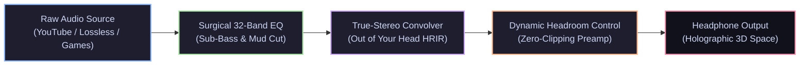

<div align="center">

```
   ███████╗██████╗  █████╗ ████████╗██╗ █████╗ ██╗
   ██╔════╝██╔══██╗██╔══██╗╚══██╔══╝██║██╔══██╗██║
   ███████╗██████╔╝███████║   ██║   ██║███████║██║
   ╚════██║██╔═══╝ ██╔══██║   ██║   ██║██╔══██║██║
   ███████║██║     ██║  ██║   ██║   ██║██║  ██║███████╗
   ╚══════╝╚═╝     ╚═╝  ╚═╝   ╚═╝   ╚═╝╚═╝  ╚═╝╚══════╝
      A U D I O   E N H A N C E M E N T   S U I T E
```

### Turn ordinary headphones into a multi-thousand-dollar holographic acoustic room.

[](#)
[](#)
[](#)
[](#)
[](#)

<p align="center">
  <a href="#-quick-install">Quick Install</a> •
  <a href="#-curated-presets">Curated Presets</a> •
  <a href="#-acoustic-engineering">Acoustic Engineering</a> •
  <a href="#-cli-switcher">CLI Switcher</a>
</p>

---

</div>

## ⚡ Overview

**`dotfiles-audio`** is a precision-engineered spatial audio and acoustic mastering suite for **Linux (PipeWire + EasyEffects 8+)**.

By combining **True-Stereo (4-channel) Head-Related Impulse Responses (HRIR)**, calibrated 32-band parametric EQ curves, and transparent dynamic management, it eliminates in-head localization fatigue and delivers an expansive, speaker-like three-dimensional soundstage without muddy phase distortion or digital clipping.



---

## 🎧 Curated Presets

| Preset | Target Soundstage | Acoustic Engine | Best For |
| :--- | :--- | :--- | :--- |
| **`Ultimate-Spatial-OutOfYourHead`** <br>*(Recommended)* | **Audiophile Listening Room**<br>Wide natural speaker simulation | Measured High-End Room HRTF (OOYH) | Vocals, Jazz, Acoustic, Long-Session Listening |
| **`Music-Crystal-UltraWide`** | **Wide Stereo + Zero Reverb**<br>140% Stereo expansion, razor-sharp transients | Stereo Tools (Mid/Side) + Crystalizer | EDM, Synthwave, Rock, Fast Drums |
| **`Ultimate-Spatial-MaxxSpace`** | **3D Cinema Dome**<br>Spherical immersion & height perception | Waves MaxxSpace Wavefront Synthesis | Anime, Sci-Fi Movies, Atmospheric Soundtracks |
| **`Ultimate-Spatial-RazerSurround`** | **Club & Arena Immersion**<br>Massive lateral wall of sound + deep sub-bass | Razer Virtual Surround (+20 Bass) | Bass-Heavy Trap, Hip-Hop, Action Films |
| **`Spatial-GSX-Gaming`** | **Competitive Micro-Positioning**<br>Ultra-accurate distance & footsteps | Sennheiser GSX 1000 Binaural Matrix | FPS (CS2, Apex, Valorant, Tarkov) |
| **`Spatial-Dolby-Atmos`** | **Cinematic Enclosure**<br>Balanced surround envelope | Dolby Atmos Reference Profile | Blockbuster Movies & Netflix |

---

## 🔬 Acoustic Engineering Highlights

### 1. Zero-Clipping Headroom Engineering
Unlike generic EQ boosters that push digital audio past `0 dBFS` causing hard harmonic distortion, all presets integrate an **exact `-6.5 dB to -7.0 dB` mathematical headroom margin**. 
- Full dynamic transients are preserved without crackle or ducking.
- Volume can be pushed as loud as your DAC/amp can drive without digital artifacts.

### 2. 4-Channel True-Stereo Binaural Synthesis
HeSuVi multi-channel surround matrices have been extracted and re-encoded into **True-Stereo (LL, LR, RL, RR)** impulse responses natively understood by EasyEffects 8+:
- Left ear hears Front-Left + crosstalk from Front-Right.
- Right ear hears Front-Right + crosstalk from Front-Left.
- Preserves natural ITD (Interaural Time Difference) and ILD (Interaural Level Difference).

### 3. Surgical Drum & Synth Sculpting
- **Sub-Bass Foundation (30–60 Hz, +3.5 dB)**: Tight, authoritative chest punch.
- **Mid-Mud Evacuation (250–400 Hz, -2.5 dB)**: Cuts the boxy "cardboard" frequency pocket to reveal hidden vocal textures and synth layers.
- **Transient Snap (2–3 kHz, +2.5 dB)**: Crisp snare strike and sharp synth-lead attack.
- **Air & Shimmer (8–12 kHz, +3.2 dB)**: Natural decay of cymbals and spatial room boundaries.

---

## 🚀 Quick Install

```bash
# 1. Clone the repository
git clone https://github.com/lazytatzv/dotfiles-audio.git ~/dotfiles-audio

# 2. Enter and run the symlink installer
cd ~/dotfiles-audio
./install.sh
```

The script automatically:
- Links all calibrated `.irs` files into `~/.local/share/easyeffects/irs/`.
- Links preset JSONs into `~/.local/share/easyeffects/output/`.
- Ready for hot-reloading with zero daemon restarts required.

---

## 🕹️ CLI Switcher

Switch your acoustic environment on the fly directly from the terminal or bind to your window manager (Hyprland / i3 / GNOME / Sway):

```bash
# True Audiophile Speaker Stage
easyeffects -l Ultimate-Spatial-OutOfYourHead

# Punchy Zero-Reverb UltraWide
easyeffects -l Music-Crystal-UltraWide

# 3D Cinema / Sci-Fi Experience
easyeffects -l Ultimate-Spatial-MaxxSpace

# Competitive FPS Footsteps
easyeffects -l Spatial-GSX-Gaming
```

---

## 📜 Uninstallation

```bash
cd ~/dotfiles-audio
./uninstall.sh
```
Cleanly purges all symlinks from EasyEffects without touching your personal configurations.

---

<div align="center">
  <sub>Crafted for pristine sound reproduction on modern Linux desktops.</sub>
</div>
